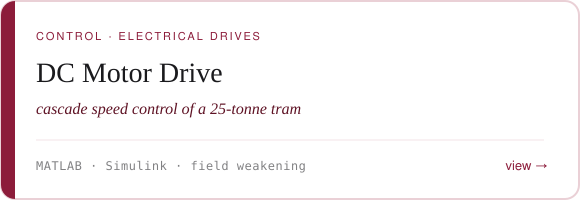

<p align="center">
  
</p>

<p align="center">
  
  
  
  
  
</p>

<p align="center"><i>
I like systems that have to obey physics: machines with inertia, loops with limits, nodes on a battery.<br>
I like a model I can derive, a controller I can explain, and a plot that tells me whether both were right.
</i></p>

---

### ✦ Selected work

<p align="center">
  <a href="https://github.com/Golsa-lab/dc-motor-drive-tramway"></a>
  <a href="https://github.com/Golsa-lab/iot-project-wokwi-esp32"></a>
</p>

| Project | What's inside |
|:--|:--|
| [**DC Motor Drive**](https://github.com/Golsa-lab/dc-motor-drive-tramway) | Equivalent-machine modelling of a four-motor tram, cascade PI speed/current control, field weakening above base speed, variable torque limit, back-calculation anti-windup and gravity feed-forward over a 10 km mission. |
| [**Sleepy Sensor Node**](https://github.com/Golsa-lab/iot-project-wokwi-esp32) | ESP32 duty-cycled node: PIR + LDR sensing, ESP-NOW broadcast, timer deep sleep and per-phase `micros()` timing for energy analysis. |

---

### ✦ Toolbox

```text
modelling & control    MATLAB · Simulink · Control System Toolbox · pidtune
embedded               C/C++ · Arduino-ESP32 · ESP-NOW · deep sleep · Wokwi
writing                LaTeX · technical reports
```

---

<p align="center">
  <sub>Politecnico di Milano</sub>
</p>
