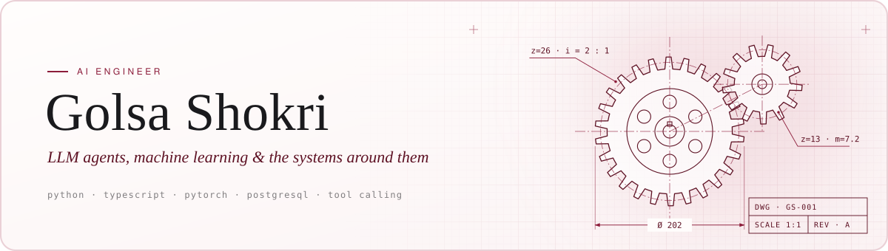
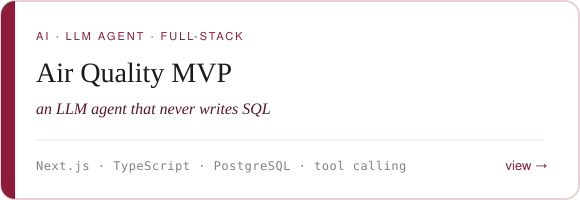
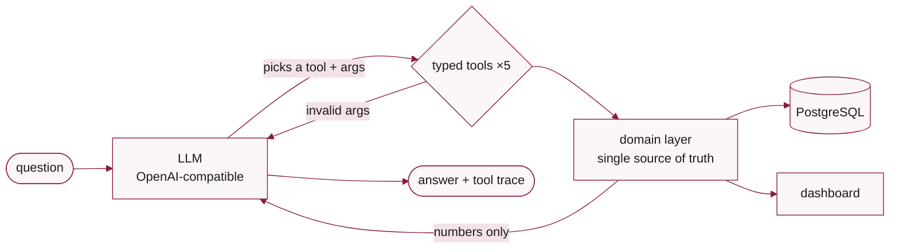
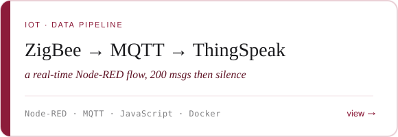
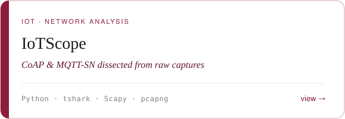
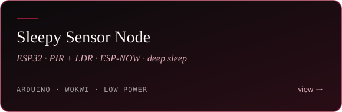
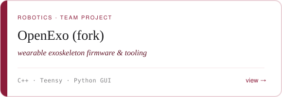

  

  
  

<i>
I build LLM agents that call typed tools instead of making things up, 
the full-stack apps around them, and the data pipelines that feed them.
</i>

---

### ✦ About

- 🎓 **M.Sc. Automation Engineering** at Politecnico di Milano (2026–), admitted directly after my B.Sc. there (2022–2026)
- 🤖 Main interest: **AI engineering**, meaning LLM agents with tool / function calling, model training and evaluation, and checking results independently
- 🧱 Hands-on full-stack: **Next.js / React / TypeScript**, **PostgreSQL** schemas and SQL, **Python** ETL, **Docker**
- 🔌 Background in control and embedded systems, so I'm comfortable where software meets sensors and actuators

### ✦ Right now

| | |
|:--|:--|
| **InVox** · Polimi Data Science & BEA | AI/ML team on a wearable that helps people with speech impairments communicate. Facial-muscle movements read by motion sensors are classified into intended phrases. I built the training dataset from scratch and the **SVM classifier** in Python (currently a 5-phrase vocabulary). |
| **Leg Aid** · AEA Polimi | Software team for a wearable robotic **exoskeleton**: integration and control logic, mainly in Python. |

---

### ✦ Featured: an LLM agent you can audit

**[Air Quality MVP](https://github.com/Golsa-lab/air-quality-mvp)** analyses ARPA Lombardia air-quality data, and you can ask it
questions in plain Italian.

The model **never sees the database and never writes SQL**. It chooses one of **5 typed tools**. Invalid arguments are
rejected and sent back so the model can correct itself, and every answer shows the tools that produced it.
The dashboard and the agent go through the **same domain layer**, so they cannot give different numbers for the same question.
A separate pandas script recomputes the SQL aggregations from the raw CSVs as an independent check.

 

---

### ✦ Projects

  
  

  
  

  

| Project | Highlights |
|:--|:--|
| [**Air Quality MVP**](https://github.com/Golsa-lab/air-quality-mvp) | Next.js + PostgreSQL in Docker, layered architecture, LLM agent with tool calling and self-correction, Python ETL with `COPY` bulk load, duplicate/conflict detection, Vitest |
| [**ZigBee → MQTT → ThingSpeak**](https://github.com/Golsa-lab/iot-nodered) | Node-RED flow over a Dockerised Mosquitto broker: O(1) packet lookup, ZCL attribute mining (RMS V/I, active power), rate-limited ThingSpeak upload, live charts |
| [**IoTScope**](https://github.com/Golsa-lab/iotChallenge-2--IoTScope-Network-Protocol-Analysis-Platform) | CoAP and MQTT-SN analysis of raw `.pcapng` captures with Python + tshark, plus a verification script for every answer |
| [**DC Motor Drive**](https://github.com/Golsa-lab/dc-motor-drive-tramway) | Cascade PI speed/current control, field weakening, variable torque limit, anti-windup, gravity feed-forward (MATLAB/Simulink) |
| [**Sleepy Sensor Node**](https://github.com/Golsa-lab/iot-project-wokwi-esp32) | ESP32 + PIR + LDR, ESP-NOW broadcast, timer deep sleep, per-phase `micros()` timing |
| [**OpenExo** (fork)](https://github.com/Golsa-lab/OpenExo) | Fork of the open-source exoskeleton platform (Teensy firmware, Python GUI, apps) |

<b>Not on GitHub (yet)</b>

 

- **AutoPrice Analyzer** (group project, PyTorch). A multi-branch network that assigns a car to a price band from its image and attributes. I wrote the **feature sub-network**, a fully-connected regressor on make, fuel, year, km and gearbox, trained with MSE + Adam.
- **Wearable denture locator**. Event-driven **BLE** firmware with a wake-on-motion state machine. I modelled 24-hour power consumption and IEEE 802.15.4 / frame-slotted ALOHA efficiency.

---

### ✦ Toolbox

  <b>AI / ML</b>&nbsp;
  
  
  
  

  <b>Languages</b>&nbsp;
  
  
  
  
  
  

  <b>Web &amp; data</b>&nbsp;
  
  
  
  
  

  <b>DevOps</b>&nbsp;
  
  
  
  

  <b>IoT &amp; embedded</b>&nbsp;
  
  
  
  
  

---

  🇮🇹 Italian C2 · 🇬🇧 English C1 · 🇩🇪 German A1 
  Politecnico di Milano · Milano / Brescia

